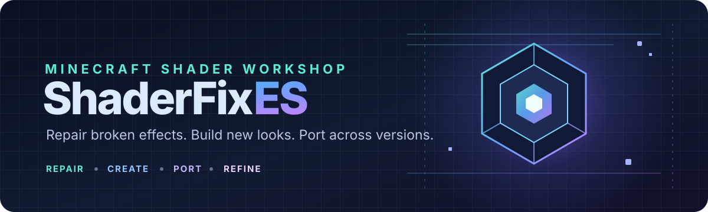

# ShaderFixES

  <strong>Repair. Create. Port. Refine.</strong> 
  A workshop for Minecraft shader fixes, experiments, and cross-version ports.

  

  
  
  

**ShaderFixES** is a dedicated workspace for making shaders work better: repairing broken effects, developing original shaders, adapting shader packs between Minecraft versions, and documenting what changed and why.

Each shader project gets its **own branch**, keeping experiments isolated and making it easier to compare fixes, preserve working versions, and revisit old ports.

## What happens here?

| Track | Purpose |
|---|---|
| 🛠️ **Fix** | Diagnose compile errors, crashes, visual artifacts, and compatibility problems. |
| ✨ **Create** | Build original shader effects and complete shader projects. |
| 🔁 **Port** | Adapt shaders across Minecraft versions, loaders, and supported shader pipelines. |
| 🔬 **Experiment** | Test rendering techniques, performance improvements, and alternative implementations. |
| 📚 **Document** | Keep technical notes, known issues, test conditions, and change history alongside the code. |

## Branch strategy

The **main** branch is the project index and shared documentation hub. Keep individual shader work on separate branches.

Suggested naming:

- **fix/shader-name-issue** — repair an existing shader
- **create/shader-name** — new shader development
- **port/shader-name-from-to** — version port
- **experiment/topic** — isolated technical experiments

Examples:

~~~text
main
fix/ethereal-water-outline
create/soft-pixel-shadows
port/legacy-shader-1.17-to-1.20
experiment/mobile-cloud-rendering
~~~

A branch should focus on **one shader or one tightly related task**. Keep unrelated shader projects separate. Merge into main only when the work is ready to be documented or shared.\n\n### Starting a new shader project\n\nUse the reusable [shader project template](templates/shader-project/README.md) and [testing notes template](templates/shader-project/TESTING.md). When starting a project, create a branch from `main`, copy the template files into that branch's root, fill in the project details, and keep shader-specific source and evidence on that branch. The `templates/` directory on `main` is the canonical starter kit, not the working copy of a shader.

## A good shader project includes

- **Original source and attribution** where applicable.
- **Target environment:** Minecraft version, loader, renderer, and shader mod/version.
- **Problem or goal:** a clear description of what is broken or what should change.
- **Changes made:** key files, techniques, and reasons for the changes.
- **Testing notes:** what was tested, what worked, and what remains unverified.
- **Known limitations:** visual compromises, compatibility issues, and performance costs.

For fixes, preserve a clean baseline whenever licensing and source availability allow. Prefer small, testable changes over rewriting unrelated effects.

## Suggested project layout

Use the structure that fits each shader. Not every project needs every folder.

~~~text
ShaderFixES/
├── README.md                 # Project hub and workflow
├── CONTRIBUTING.md            # Contribution and testing standards
├── LICENSE                    # Repository-wide license, when selected
├── assets/                    # Repository artwork
├── docs/                      # Shared notes and conventions
└── <shader-project-branch>/   # Shader-specific source lives on its branch
    ├── README.md              # Target, changes, setup, test results
    ├── shaders/               # Shader source files
    ├── screenshots/           # Before/after comparisons
    └── notes/                 # Debug logs and porting notes
~~~

## Quality rules

1. **Keep the visual target explicit.** Use reference screenshots when appearance matters.
2. **Test before claiming a fix.** Separate confirmed results from assumptions.
3. **Respect upstream work.** Preserve copyright notices and follow the original shader's license before modifying or redistributing it.
4. **Record compatibility precisely.** A shader working on one renderer or version does not guarantee it works on another.
5. **Watch performance.** Record settings and hardware for meaningful comparisons, especially on mobile.
6. **Keep changes reviewable.** Explain the cause, the fix, and any trade-offs.

## Current status

This repository is a fresh workshop. Shader-specific projects will be added on their own branches as work begins.

**Have a shader that needs fixing or porting?** Open an issue with the shader name, Minecraft version, renderer, logs, screenshots, and steps to reproduce the problem.

---

  ShaderFixES · A shader workshop by <a href="https://github.com/Im-new-code">Im-new-code</a>

